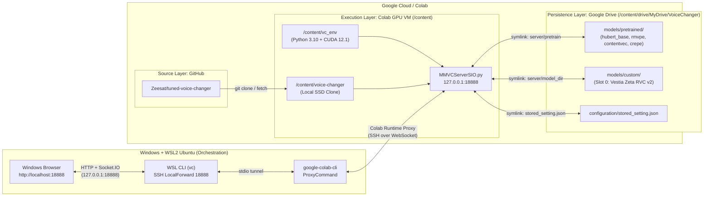

# Architecture — Tuned Voice Changer (Colab GPU + WSL Orchestration)

## 1. Three-Layer Architectural Separation

The system enforces strict separation between **Source**, **Persistence**, and **Execution** so that ephemeral Google Colab GPU runtimes can be created, destroyed, or replaced at any time without losing models, indexes, or configuration.

---

## 2. Layer Responsibilities

| Layer | Location | Persistence | Responsibilities |
|---|---|---|---|
| **Source** | `https://github.com/Zeesat/tuned-voice-changer.git` | Version-controlled | Application source code, defect fixes, `deployment/colab/*.sh` lifecycle scripts, and pinned dependency specification. |
| **Persistence** | `/content/drive/MyDrive/VoiceChanger/` | Permanent (Google Drive) | Pretrained base weights (`models/pretrained`), custom RVC voice models and FAISS indexes (`models/custom`), raw backups (`checkpoints/`, `indexes/`), and `configuration/stored_setting.json`. |
| **Execution** | `/content/voice-changer` & `/content/vc_env` | Ephemeral (Colab SSD) | Dedicated Python 3.10 virtual environment, compiled native/CUDA libraries, active Git working tree, `tmp_dir`/`upload_dir` scratch space, and the running `MMVCServerSIO.py` ASGI process. |

---

## 3. Real-Time Audio & Control Transport

- **Single-Port Multiplexing (`127.0.0.1:18888`)**:
  - `MMVCServerSIO.py` wraps a FastAPI application (`MMVC_Rest`) inside an `AsyncServer` Socket.IO ASGI app (`MMVC_SocketIOApp`) served by Uvicorn on TCP port `18888`.
  - **REST API (`/info`, `/test`, `/api/hello`, `/model_dir/...`)**: Handles configuration updates, model slot inspection, file uploads, and static frontend delivery (`client/demo/dist`).
  - **Socket.IO (`/socket.io/?EIO=4`, namespace `/test`)**: Streams real-time audio chunks (`request_message` event carrying `[timestamp, int16_pcm_bytes]`) and returns converted PCM audio (`response` event).
- **Private Local Access via SSH Port Forwarding**:
  - The server binds to `127.0.0.1:18888` inside the Colab container.
  - WSL establishes an SSH `LocalForward 18888 127.0.0.1:18888` over `colab ssh --proxy-mode -s <session>`.
  - Because Windows and WSL2 share `localhost` loopback forwarding, opening `http://localhost:18888` in the Windows browser treats the origin as a **Secure Context**, enabling Web Audio API `navigator.mediaDevices.getUserMedia({ audio: true })` without requiring self-signed HTTPS certificates or third-party public tunnels (ngrok/cloudflared).
